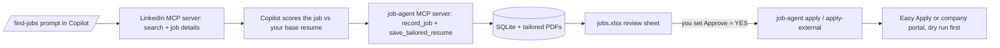

# job-bot

Personal job-search assistant that works inside **VS Code Copilot agent mode**.

It searches LinkedIn for jobs that match your resume, scores each one, rewrites your resume for each job **using only facts from your own base resume**, writes a spreadsheet for you to review, and applies **only to the rows you mark `Approve = YES`**.

There is no separate LLM API. Copilot (the chat agent) does the scoring and the resume writing. The Python code in this repo does everything else: it stores data, renders PDFs, builds the spreadsheet and drives the browser.

> **Use at your own risk.** LinkedIn's User Agreement prohibits automated access, and accounts that use automation can be restricted. Keep volumes small, review everything, and never apply to roles you would not take. This project does not try to evade captchas or bot detection.

## How it works



Two MCP servers are configured in [.vscode/mcp.json](.vscode/mcp.json):

| Server | What it is | Used for |
|---|---|---|
| `linkedin` | The open-source [`mcp-server-linkedin`](https://pypi.org/project/mcp-server-linkedin/), run with `uvx` | `search_jobs`, `get_job_details`, `get_job_apply_url` |
| `job-agent` | This project (`job-agent serve`) | Base resume, job database, keyword coverage, tailored PDFs, spreadsheet |

**Rules the design follows**

- The `Approve` column in the spreadsheet is the **only** gate for applying. Nothing is applied to without `YES`.
- Every apply command is a **dry run by default**. Pass `--live` to actually submit.
- Tailored resumes may reorder, reword and emphasize real experience, but must not invent employers, titles, dates, skills or metrics.
- Keyword gaps that remain after tailoring are real gaps and are left alone.

## Requirements

- Python 3.10 or newer
- VS Code with GitHub Copilot (agent mode, MCP support)
- [`uv`](https://docs.astral.sh/uv/) (installed as a dependency, so `uvx` is available in the venv)
- A LinkedIn account
- macOS is what this was built and tested on. Portal passwords use the OS keychain through the `keyring` package, which also supports Windows and Linux backends, but those are untested.

## Setup

```bash
git clone https://github.com/NakS15/job-bot.git
cd job-bot

python3 -m venv .venv
.venv/bin/pip install -e .
.venv/bin/playwright install chromium
```

The data directory is `~/.job-agent/` (override with the `JOB_AGENT_HOME` environment variable). It is created on first use and is **not** part of the repo.

### 1. Import your base resume

```bash
.venv/bin/job-agent import-resume /path/to/your_resume.pdf
```

This stores the PDF and its extracted text. Check the extracted text (`~/.job-agent/resumes/base.txt`): it is the only source of truth for tailoring. If your resume has skills that live inside frameworks (for example Spring Security under Spring Boot), add a short "Additional skills (confirmed)" section to the end of `base.txt` so job keywords can match them.

### 2. Create `~/.job-agent/profile.yaml`

The file is created with minimal defaults the first time something reads it. Edit it to match the template below. See [What you need to add](#what-you-need-to-add) for what each key does.

### 3. Sign in to LinkedIn (two separate sessions)

```bash
# Session used by the LinkedIn MCP server for search and job details
.venv/bin/uvx mcp-server-linkedin@latest --login

# Separate browser profile used by this project's apply commands
.venv/bin/job-agent login
```

Each opens a browser window. Sign in (including any 2FA or captcha) and close it as instructed.

### 4. Start the MCP servers

Open this folder in VS Code. In [.vscode/mcp.json](.vscode/mcp.json) start both servers (**MCP: List Servers** in the Command Palette, or the Start link above each entry). If you change `profile.yaml`'s `sheet_path` or `mcp.json`, restart the `job-agent` server.

## What you need to add

Everything personal lives in `~/.job-agent/` and is never committed (the repo's `.gitignore` excludes PDFs, spreadsheets and debug output).

| Item | Where | Why |
|---|---|---|
| Base resume PDF | `job-agent import-resume` | Source of truth for scoring and tailoring |
| `profile.yaml` | `~/.job-agent/profile.yaml` | Search preferences and form answers (below) |
| LinkedIn login for search | `uvx mcp-server-linkedin@latest --login` | The LinkedIn MCP server needs a signed-in session |
| LinkedIn login for applying | `job-agent login` | Apply commands use their own browser profile |
| Portal account passwords | `job-agent set-password <host>` | Only for company portals that need a password (stored in the keychain) |

### `profile.yaml` reference

```yaml
sheet_path: "~/job-bot/jobs.xlsx"     # optional; default is ~/.job-agent/jobs.xlsx

preferences:
  titles: ["Backend Engineer", "Java Developer"]
  locations: ["City, State, Country", "Remote"]
  min_match: 70                        # jobs scoring below this are skipped
  max_jobs_per_search: 10

apply:
  max_per_run: 10                      # cap on Easy Apply submissions per run
  min_delay_seconds: 25                # random pause between applications
  max_delay_seconds: 60

# Lowercase substring of a form question -> answer. The longest matching key wins.
# A key with an empty value means "leave this field blank".
answers:
  email: "you@example.com"
  phone: "0000000000"
  phone extension: ""                  # blank on purpose: stops "phone" matching this field
  first name: "Given"
  last name: "Family"
  years of experience: "4"
  authorized to work: "Yes"
  sponsorship: "No"
  notice period: "30"
  current ctc: "0"                     # only if forms ask; never invent numbers you would not give
  expected ctc: "0"
  city: "Your City"
  address line 1: "Street address"
  postal code: "000000"
  linkedin: "https://www.linkedin.com/in/your-handle/"
  portfolio: "https://example.com"

# Used by company portals that have "work experience" / "education" sections.
# Every value should come from your resume. Dates are MM/YYYY.
work_history:
  - company: "Company A"
    title: "Your Title"
    location: "City, Country"
    start: "06/2022"
    end: ""
    current: true
    description: "What you did, copied or condensed from your resume."
education:
  - school: "University"
    degree: "Bachelor of Engineering"
    field: "Your Field"
    location: "City, Country"
    end: "05/2022"
    gpa: "8.0/10"

# Free-text (textarea) answers, matched by the question text.
long_answers:
  tech stack: "Describe your stack using only things on your resume."
  notice period: "30 days"

# Checkboxes ticked by their option text (for example a pronouns group).
checkbox_choices: ["he/him"]

# A checkbox is ticked only if its label contains one of these phrases.
# Anything else that is required is left for you.
consent_phrases: ["privacy", "terms", "agree", "acknowledge", "consent"]
```

Declarations that only you can answer (relatives at the company, government-official relationships and similar) are never guessed. If a required question has no answer in `answers`, the run stops and names it, and you add the answer and rerun.

## Daily use

### 1. Find and tailor

In Copilot Chat (agent mode), run the **`/find-jobs`** prompt ([.github/prompts/find-jobs.prompt.md](.github/prompts/find-jobs.prompt.md)). It will:

1. Read your preferences and base resume.
2. Run LinkedIn searches **one call at a time** (parallel LinkedIn calls crash the browser).
3. Read shortlisted jobs, check whether each is Easy Apply or external, and score them.
4. Record jobs at or above `min_match`, and write a tailored resume PDF for each.
5. Build the spreadsheet.

It does **not** apply.

### 2. Review

Open the spreadsheet (`sheet_path` in `profile.yaml`, default `~/.job-agent/jobs.xlsx`). Read the tailored resume for each row you care about, then set **`Approve`** to `YES` for the jobs you want (`NO` or blank skips them). Save and close the file.

Columns: Approve, Job ID, Title, Company, Location, Apply type, URL, Match score, Original keyword %, Tailored keyword %, Still missing keywords, Changes made, Tailored resume, Status, Notes.

### 3. Apply

```bash
# LinkedIn Easy Apply: dry run first (walks the form, stops before Submit)
.venv/bin/job-agent apply
# then, when you are happy with what it filled in:
.venv/bin/job-agent apply --live

# Company portals (external applications), dry run first
.venv/bin/job-agent apply-external
.venv/bin/job-agent apply-external --live
```

Useful options for `apply-external`: `--only <job_id>` to run a single job and `--no-wait` to skip the "did you submit?" pause and close the browser at the end.

A dry run saves a screenshot of the review step and the page text under `~/.job-agent/debug/`, so you can see exactly what would be sent.

### Job statuses

`matched` → `tailored` → one of `dry_run_ok`, `external_opened`, `applied`, or `needs_manual` (with the reason in the Notes column).

## Easy Apply vs company portals

| Kind | Works unattended? |
|---|---|
| LinkedIn **Easy Apply** | Yes. Fills each step, uploads the tailored resume, and verifies LinkedIn's confirmation. |
| Company portal with a normal form | Mostly. Fills pages and stops at any question it has no answer for. |
| Portal needing a **password account** | You create the account in your normal browser, then run `job-agent set-password <portal-host>` once (hidden prompt, saved to the keychain). The tool signs in from then on. |
| Portal using **emailed sign-in links**, Google sign-in or passkeys | No. |
| Portal with a **captcha** or bot detection at sign-up or submit | No. The tool does not try to get around it. Finish those in your own browser. |

Company portals vary a lot, so expect to fix and extend the page handling in `applier.py` for new ones.

## Where things live

```
job-bot/                         (this repo: code only)
  src/job_agent/
    server.py        MCP tools for Copilot
    cli.py           job-agent commands
    applier.py       Easy Apply + company-portal automation (Playwright)
    portal_auth.py   portal sign-in / account creation
    credentials.py   keychain storage and password generation
    resume.py        PDF import, keyword coverage, tailored PDF rendering
    sheet.py         review spreadsheet
    db.py            SQLite job tracker
    config.py        paths and defaults
  .github/prompts/   /find-jobs and /apply-jobs prompts
  .vscode/mcp.json   MCP server configuration

~/.job-agent/                    (your data: never committed)
  profile.yaml  jobs.db  resumes/base.pdf  resumes/base.txt
  resumes/tailored/  browser-profile/  debug/
```

### MCP tools exposed by `job-agent`

`get_search_preferences`, `import_base_resume`, `get_base_resume`, `seen_job_ids`, `record_job`, `save_tailored_resume`, `list_jobs`, `build_spreadsheet`, `apply_approved`.

`apply_approved` is for Easy Apply only. Run it only when you explicitly ask Copilot to, and use `dry_run=true` first.

## Troubleshooting

- **LinkedIn browser crashes on a search:** the LinkedIn MCP server handles one request at a time. Run searches sequentially.
- **`Easy Apply` filter returns few or irrelevant jobs:** the filter is loose and the pool is small. Use `get_job_apply_url` as the authority on whether a job is Easy Apply, and widen the location or date range.
- **A portal says the form was not reached:** read `~/.job-agent/debug/<job_id>.png` and `<job_id>.json` (the visible controls). Password values are masked there.
- **`apply` skips a row:** its `Approve` cell must be exactly `YES`, its status must be `tailored`, `needs_manual` or `dry_run_ok`, and the sheet must be saved and closed.
- **Wrong spreadsheet location after changing `sheet_path`:** restart the `job-agent` MCP server so it picks up the new path.
- **Stale browser holding the profile:** make sure no leftover `job-agent` or Chromium process is running before a new apply run.

## Security and privacy

- Passwords are generated or stored in the OS keychain only. They are never written to files, logs, debug captures or terminal output.
- Do not paste passwords, tokens or one-time links into chat. Use `job-agent set-password` (hidden prompt) instead.
- Keep `profile.yaml`, resumes, the database and the spreadsheet out of git. If you fork this repo, check `git status` before every commit.
